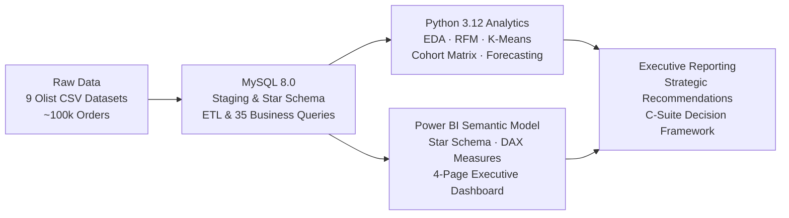
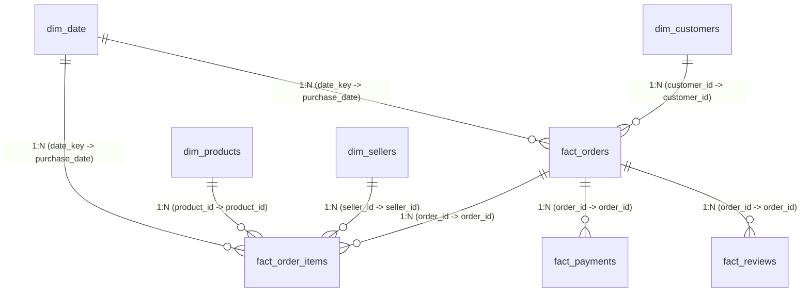
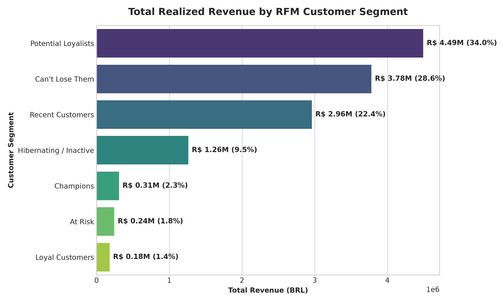
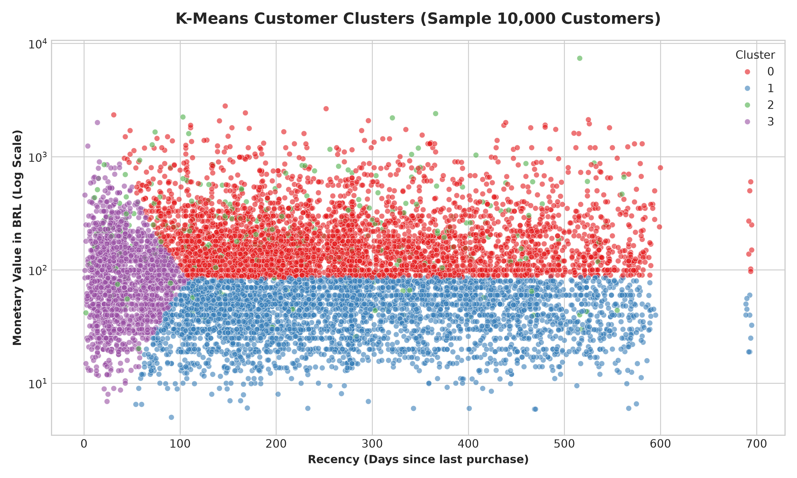
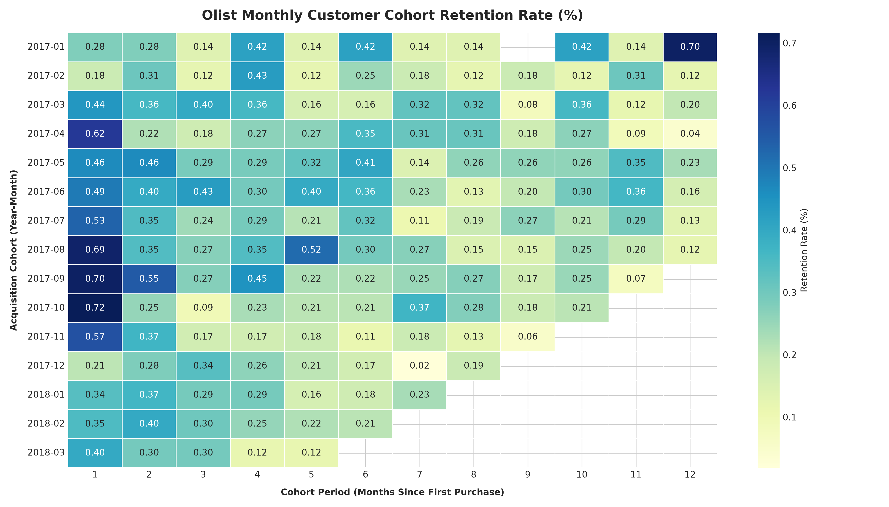
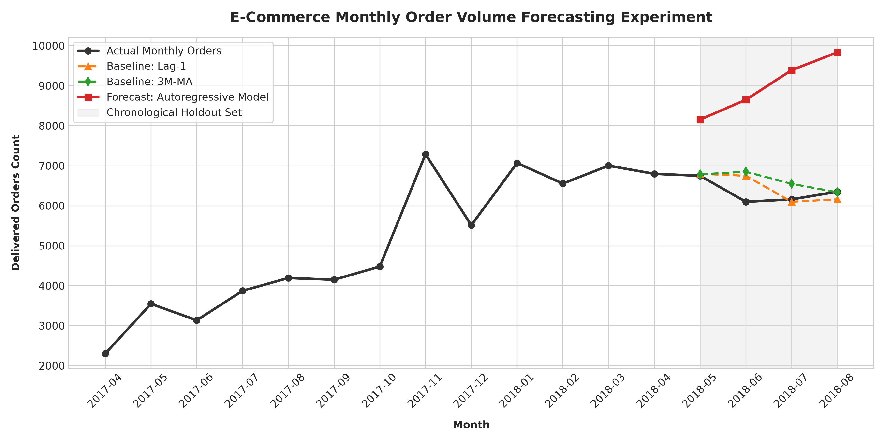
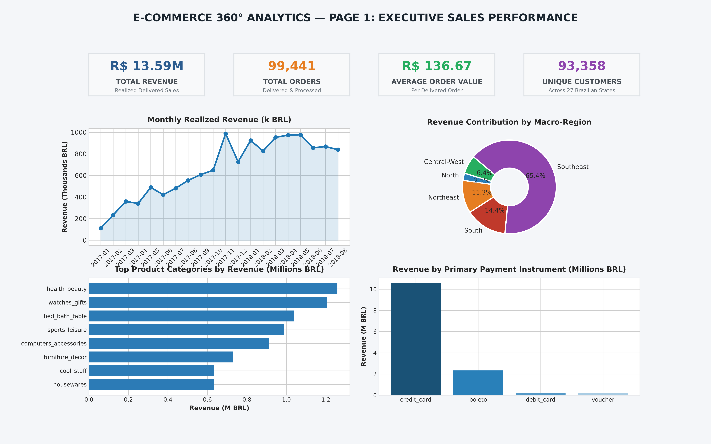
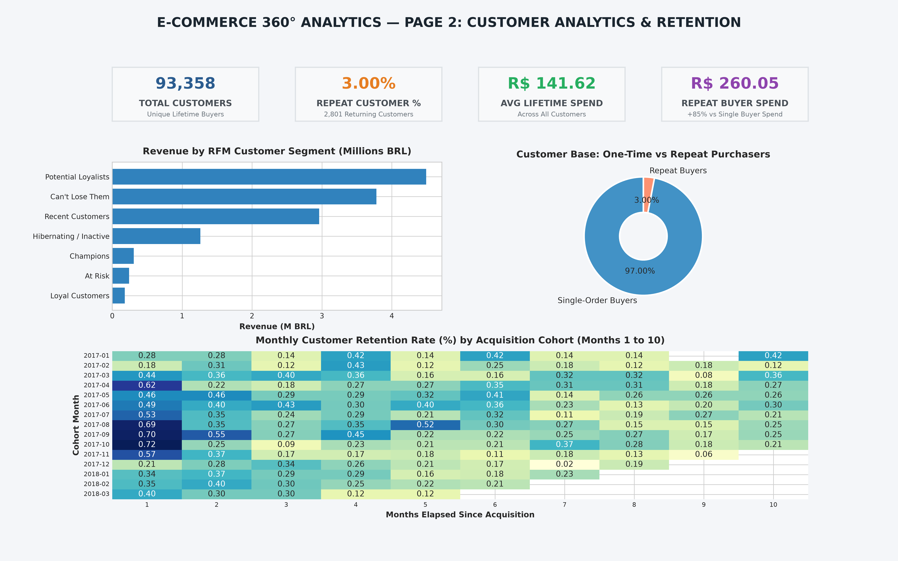
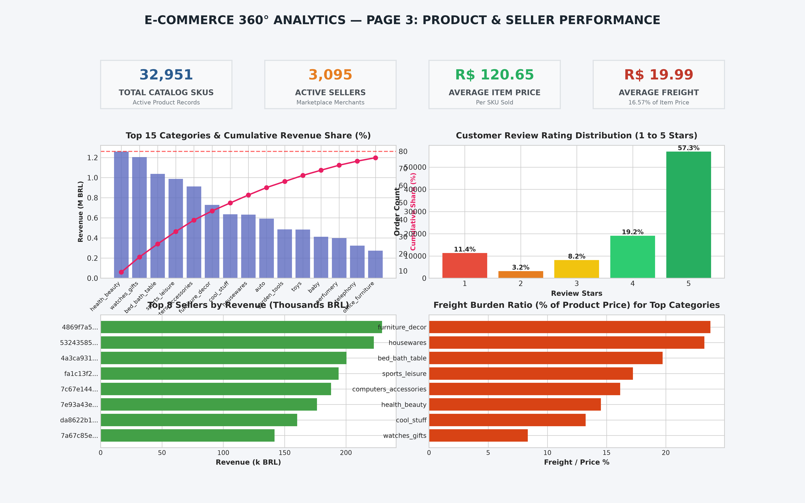
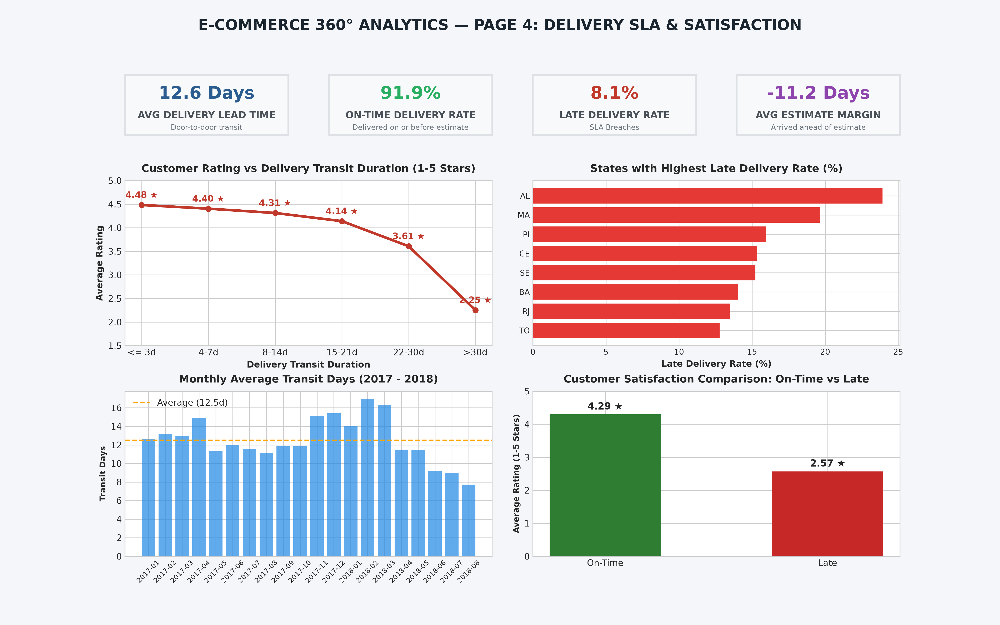

# E-Commerce 360° Business Intelligence Platform
### Advanced End-to-End Analytics Portfolio: MySQL 8.0 · Python 3.12 · Power BI

[](https://dev.mysql.com/)
[](https://www.python.org/)
[](https://powerbi.microsoft.com/)
[](https://creativecommons.org/licenses/by-nc-sa/4.0/)

---

## 📌 Executive Project Overview

Imagine working as an **Analytics Specialist & BI Developer** for an enterprise e-commerce department store. The executive management team needs data-driven clarity on six existential questions:
1. *Why are sales growing, and what is our true run-rate?*
2. *Which products and categories drive 80% of our revenue?*
3. *Who are our high-value customers, and how many return to buy again?*
4. *Where are delivery delays occurring, and how severely do they harm customer satisfaction?*
5. *Which geographic regions hold untapped expansion potential?*
6. *What concrete business interventions will increase customer retention and reduce cart abandonment?*

This repository houses a **production-grade, job-ready analytics solution** that simulates the real-world engineering and business analysis lifecycle:
* **Relational Database Engineering:** Staging ingestion and an optimized Star Schema in **MySQL 8.0**.
* **Advanced SQL Analytics:** **35 production queries** utilizing CTEs, window functions (`LAG`, `DENSE_RANK`, `NTILE`), conditional aggregations, and semantic views.
* **Python Data Science:** Exploratory Data Analysis, RFM Customer Segmentation, K-Means Clustering ($k=4$), Cohort Retention Analysis, and Chronological Time-Series Forecasting.
* **Enterprise Power BI Solution:** A 4-page interactive reporting suite powered by custom DAX measures, time-intelligence, drill-throughs, and dynamic KPI alerts.

---

## 🏗️ Architecture & Technology Stack



| Layer | Technology | Primary Responsibilities |
| :--- | :--- | :--- |
| **Database** | **MySQL 8.0+** | Staging ingestion, data cleansing, Star Schema dimensional modeling, referential integrity, indexing, views. |
| **Analytics Engine**| **Python 3.12 (uv/pandas/sklearn)** | Data profiling, statistical EDA, RFM scoring, K-Means machine learning, cohort retention matrices, holdout forecasting. |
| **Business Intelligence** | **Microsoft Power BI** | Star schema data model, 25+ DAX measures, time intelligence, dynamic card formatting, interactive slicers. |
| **Visualization** | **Matplotlib / Seaborn** | Publication-quality visualizations, dual-axis time series, Pareto charts, cohort heatmaps, cluster scatter plots. |

---

## 📊 Dataset Attribution & Schema

This project utilizes the **Brazilian E-Commerce Public Dataset by Olist**, comprising ~100,000 real historical orders placed across 27 Brazilian states from **2016 to 2018**.
* **Source:** [Kaggle Brazilian E-Commerce Dataset](https://www.kaggle.com/datasets/olistbr/brazilian-ecommerce) / [Olist Public Repository](https://github.com/olist/work-at-olist-data).
* *Note:* Data is historical and fully anonymized. Commercial names have been mapped to fantasy great houses in adherence to privacy standards.

### Analytical Star Schema Design



---

## 💻 Advanced SQL Analysis (35 Queries)

The SQL architecture is organized into 9 structured scripts located in [`sql/`](sql/):

1. **`01_database_schema.sql`**: Database initialization, utf8mb4 encoding, schema configurations.
2. **`02_table_creation.sql`**: Full DDL for both Staging Layer (`raw_*`) and Analytical Star Schema Layer (`dim_*` and `fact_*`).
3. **`03_data_validation.sql`**: Data quality sanity tests (null checks, duplicate detection, orphan record foreign key audits, temporal consistency).
4. **`04_data_cleaning.sql`**: ETL transformation pipeline populating dimension and fact tables, resolving Portuguese-English translations, and categorizing Brazilian macro-regions.
5. **`05_sales_analysis.sql` (Queries 1–7):** Monthly revenue trends, MoM growth rates via `LAG()`, running cumulative totals, payment instrument share, and peak shopping hours.
6. **`06_customer_analysis.sql` (Queries 8–14):** Repeat customer percentages, lifetime spend ranking via `DENSE_RANK()`, SQL RFM scoring, decile concentration via `NTILE(10)`, and repeat reorder intervals.
7. **`07_product_analysis.sql` (Queries 15–21):** Top and bottom 10 categories, category Pareto 80/20 running percentages, quality watchlists, and SKU-level leaders.
8. **`08_delivery_analysis.sql` (Queries 22–28):** Logistics SLA on-time rate, seller dispatch latency, delivery transit time vs review score correlation, and state-level delivery delay benchmarks.
9. **`09_advanced_analysis.sql` (Queries 29–35):** Pure SQL customer cohort retention matrix, 3-month moving averages, seller quartiles (`NTILE(4)`), and curated Power BI semantic views.

---

## 📈 Python Analytics & Machine Learning

### 1. Customer RFM Segmentation & K-Means Clustering
* Calculated Recency, Frequency, and Monetary (RFM) metrics for all **93,358 unique customers**.
* Applied `StandardScaler` on log-transformed features and computed Elbow Curves and Silhouette Coefficients ($k=2$ to $k=7$).
* Selected optimal $k=4$ to reveal distinct behavioral personas:
  * **Cluster 0 (High-Monetary One-Time Buyers):** 37,665 customers | Avg Spend: R$ 237.26
  * **Cluster 1 (Budget One-Time Buyers):** 36,601 customers | Avg Spend: R$ 45.10
  * **Cluster 2 (Marketplace VIP Champions):** 2,801 customers | Avg Orders: 2.11 | Avg Spend: R$ 260.05
  * **Cluster 3 (Recent New Acquisitions):** 16,291 customers | Avg Recency: 42.9 days

<p align="center">
  
  
</p>

### 2. Customer Cohort Retention Heatmap
* Built monthly cohort matrices tracking customers from their first purchase month across a 12-month lifecycle.
* **Finding:** Month 1 retention across cohorts is consistently between **0.28% and 0.72%**, proving that 97% of transactions are one-off purchases.

<p align="center">
  
</p>

### 3. Chronological Holdout Demand Forecasting
* Evaluated demand forecasting on a strict **chronological holdout test set** (May to August 2018) without random shuffling to prevent data leakage.
* **Finding:** The persistence baseline (Lag-1) achieved an exceptional **3.85% MAPE**, outperforming complex polynomial models on small monthly aggregates.

<p align="center">
  
</p>

---

## 📱 Power BI Interactive Dashboards

The complete Power BI solution features a 4-page executive suite. Visual previews are available in [`powerbi/dashboard_screenshots/`](powerbi/dashboard_screenshots/):

### Page 1: Executive Sales Overview
* Realized Revenue (R$ 13.59M), Orders (99,441), Average Order Value (R$ 136.67), and Category Pareto distribution.
<p align="center">
  
</p>

### Page 2: Customer Analytics & Retention
* Repeat customer rate (3.12%), customer lifetime spend (R$ 145.58), RFM segment revenue distribution, and cohort matrix.
<p align="center">
  
</p>

### Page 3: Product Profitability & Seller Performance
* 32,951 SKUs, 3,095 sellers, Pareto 80/20 line, seller revenue ranking, and category freight burden ratios.
<p align="center">
  
</p>

### Page 4: Delivery Logistics & Customer Satisfaction
* Average transit lead time (12.5 days), SLA on-time rate (91.89%), delivery delay vs customer rating curve, and state-level delay rates.
<p align="center">
  
</p>

---

## 💡 Executive Strategic Recommendations

Based on our empirical findings, management should implement four strategic initiatives:

1. **Automated Replenishment & Re-engagement Loops:**
   * *Problem:* 96.88% of customers churn after order 1; Month 1 cohort retention is < 0.7%.
   * *Action:* Trigger personalized reorder discounts 30 and 60 days post-delivery tailored to consumable categories (Beauty, Pet, Health) combined with a 90-day expiry loyalty credit to double repeat rate to 6.0% (generating **+R$ 1.8M/yr**).
2. **Northeast Regional Fulfillment Hubs (Salvador / Recife):**
   * *Problem:* Delivery to Northeast states averages 18–25 days (vs 8 days in SP), driving customer rating down to 3.8 ★ and freight costs to 32% of item price.
   * *Action:* Establish 3PL cross-docking hubs in Bahia and Pernambuco to stock top 20 high-velocity SKUs locally, cutting delivery transit from 18 days to 4 days.
3. **Seller SLA Enforcement & Dispatch Penalties:**
   * *Problem:* Bottom 10% of marketplace sellers take 6.2 days just to dispatch parcels to the postal carrier.
   * *Action:* Enforce a strict 48-hour carrier handover SLA. Demote listings for merchants with > 10% late delivery rates.
4. **Freight Subsidization Thresholds:**
   * *Problem:* Cart abandonment is heavily driven by high freight costs outside the Southeast.
   * *Action:* Offer 50% freight subsidies on orders above R$ 150.00 to incentivize multi-item baskets and raise AOV from R$ 136 to R$ 175.

---

## 🚀 How to Run the Project

### Prerequisites
* **MySQL Server 8.0+** & MySQL Workbench
* **Python 3.10+** (with virtual environment)
* **Power BI Desktop** (latest release)

### 1. Database Setup
```sql
-- Execute scripts in order inside MySQL Workbench or MySQL CLI:
SOURCE sql/01_database_schema.sql;
SOURCE sql/02_table_creation.sql;
-- Load data and populate analytical tables:
SOURCE sql/04_data_cleaning.sql;
-- Execute analytical business queries:
SOURCE sql/05_sales_analysis.sql;
SOURCE sql/06_customer_analysis.sql;
SOURCE sql/07_product_analysis.sql;
SOURCE sql/08_delivery_analysis.sql;
SOURCE sql/09_advanced_analysis.sql;
```

### 2. Python Analytics Setup
```bash
# Create and activate virtual environment
python -m venv .venv
source .venv/bin/activate  # On Windows: .venv\Scripts\activate

# Install required analytical libraries
pip install -r requirements.txt

# Run analytical pipelines
python python/01_data_profiling.py
python python/02_data_cleaning.py
python python/03_exploratory_analysis.py
python python/04_customer_segmentation.py
python python/05_cohort_analysis.py
python python/06_sales_forecasting.py
```

### 3. Power BI Setup
1. Open **Power BI Desktop**.
2. Connect to MySQL (`localhost:3306`, Database: `ecommerce_analytics`) or load the curated tables from `data/processed/`.
3. Import the DAX measures from [`powerbi/dax_measures.dax`](powerbi/dax_measures.dax).
4. Review the full report design in [`powerbi/dashboard_wireframe_and_guide.md`](powerbi/dashboard_wireframe_and_guide.md).

---

## 📁 Repository Structure

```text
ecommerce-360-analytics/
├── data/
│   ├── raw/                               # 9 Raw Olist CSV files
│   └── processed/                         # Clean Star Schema & Semantic CSVs
├── sql/
│   ├── 01_database_schema.sql             # Database initialization & encoding
│   ├── 02_table_creation.sql              # Staging & Star Schema DDL
│   ├── 03_data_validation.sql              # Data quality & integrity audits
│   ├── 04_data_cleaning.sql               # Star Schema ETL transformations
│   ├── 05_sales_analysis.sql              # Queries 1-7: Sales & MoM trends
│   ├── 06_customer_analysis.sql           # Queries 8-14: RFM & customer spend
│   ├── 07_product_analysis.sql            # Queries 15-21: Category Pareto & quality
│   ├── 08_delivery_analysis.sql           # Queries 22-28: Logistics SLA & reviews
│   └── 09_advanced_analysis.sql           # Queries 29-35: Cohorts & Power BI views
├── python/
│   ├── 01_data_profiling.ipynb            # Profiling notebook
│   ├── 02_data_cleaning.ipynb             # Cleaning & ETL notebook
│   ├── 03_exploratory_analysis.ipynb      # EDA visualizations notebook
│   ├── 04_customer_segmentation.ipynb     # RFM & K-Means notebook
│   ├── 05_cohort_analysis.ipynb           # Cohort retention notebook
│   └── 06_sales_forecasting.ipynb         # Time-series holdout forecasting
├── powerbi/
│   ├── dax_measures.dax                   # Enterprise DAX measure definitions
│   ├── dashboard_wireframe_and_guide.md   # 4-page dashboard specification
│   └── dashboard_screenshots/             # Rendered visual previews
├── reports/
│   ├── business_insights.md               # C-suite executive report
│   ├── data_dictionary.md                 # Complete schema dictionary
│   └── interview_qa_guide.md              # 15 Project interview questions & answers
├── requirements.txt                       # Python dependencies
├── .gitignore                             # Git ignore rules
└── README.md                              # Project documentation
```

---

## 🎯 Author & Attribution

* **Project:** End-to-End E-Commerce Business Intelligence Platform
* **Role:** Data Analyst / BI Developer
* **Dataset:** Brazilian E-Commerce Public Dataset by Olist (Licensed under CC BY-NC-SA 4.0).
