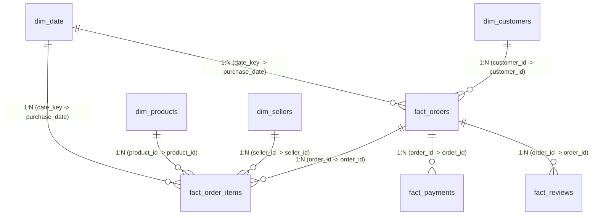

# Power BI Dashboard Architecture & Development Guide
## E-Commerce 360° Business Intelligence Platform

---

### 1. Data Model Architecture (Star Schema)

The analytical data model follows Microsoft Power BI architectural best practices. Fact tables contain numerical business measurements and foreign keys, while dimension tables provide descriptive context. All relationships are **One-to-Many (1:*)** with **Single Directional Cross-filtering** pointing from dimensions to facts to eliminate ambiguity and prevent performance degradation.

#### Table Grain and Primary Keys:
| Table | Grain | Primary Key | Foreign Keys |
| :--- | :--- | :--- | :--- |
| **`DimDate`** | 1 row per calendar day | `date_key` | None |
| **`DimCustomers`** | 1 row per customer order address | `customer_id` | `zip_code_prefix` |
| **`DimProducts`** | 1 row per product SKU | `product_id` | None |
| **`DimSellers`** | 1 row per marketplace seller | `seller_id` | `zip_code_prefix` |
| **`FactOrders`** | 1 row per order placed | `order_id` | `customer_id`, `purchase_date` |
| **`FactOrderItems`** | 1 row per item within an order | `order_item_surrogate_id` | `order_id`, `product_id`, `seller_id`, `purchase_date` |
| **`FactPayments`** | 1 row per payment transaction | `payment_surrogate_id` | `order_id` |
| **`FactReviews`** | 1 row per customer order review | `(review_id, order_id)` | `order_id` |

---

### 2. Four-Page Interactive Dashboard Specification

#### Page 1: Executive Sales Performance
* **Business Target:** Provide senior executives with an immediate 360° health check of total revenue, order momentum, top categories, and geographic distribution.
* **Top KPI Header Cards:**
  1. **Total Revenue:** `R$ 13.59M` (Format: `R$ #,##0.00`)
  2. **Total Orders:** `99,441` (Format: `#,##0`)
  3. **Average Order Value (AOV):** `R$ 136.67`
  4. **Total Unique Customers:** `93,358`
  5. **Average Review Rating:** `4.13 ★`
* **Visual Components:**
  * **Line & Clustered Column Chart:** Monthly Realized Revenue (Columns) & Order Count (Line) from 2017 to 2018.
  * **Horizontal Bar Chart:** Top 10 Product Categories by Revenue (BRL).
  * **Filled Map / Shape Map:** Revenue Contribution by Brazilian State (SP, RJ, MG highlighting Southeast concentration).
  * **Donut Chart:** Primary Payment Instrument Breakdown (Credit Card, Boleto, Voucher, Debit Card).
  * **Interactive Slicers:** Date Range Slider (`DimDate[date_key]`), Brazilian Macro-Region (`DimCustomers[region]`), Order Status (`FactOrders[order_status]`).

---

#### Page 2: Customer Analytics & Retention
* **Business Target:** Answer management's critical questions regarding customer loyalty, repeat purchasing behavior, and RFM segment value.
* **Top KPI Header Cards:**
  1. **Total Unique Customers:** `93,358`
  2. **Repeat Customer Rate:** `3.12%` (Benchmark indicator)
  3. **Average Customer Lifetime Spend:** `R$ 145.58`
  4. **Average Orders per Customer:** `1.03`
* **Visual Components:**
  * **Bar Chart with Data Labels:** Revenue by RFM Customer Segment (*Potential Loyalists, Recent Customers, Champions, At Risk, Can't Lose Them*).
  * **Matrix Visual:** Customer Cohort Retention Rate (%) across monthly acquisition cohorts (Month 0 to Month 12).
  * **Donut Chart:** New vs Repeat Customer Distribution (96.88% Single-Order vs 3.12% Repeat Buyers).
  * **Table with Conditional Formatting:** Top 20 VIP Customers ranked by total item spend, orders placed, and state.
  * **Slicers:** RFM Customer Segment, State, First Purchase Year.

---

#### Page 3: Product & Seller Analytics
* **Business Target:** Identify revenue drivers, product catalog profitability, quality issues, and seller fulfillment compliance.
* **Top KPI Header Cards:**
  1. **Total Active Products:** `32,951`
  2. **Active Marketplace Sellers:** `3,095`
  3. **Average Unit Price:** `R$ 120.65`
  4. **Average Freight per Item:** `R$ 19.99`
  5. **Freight-to-Price Ratio:** `16.57%`
* **Visual Components:**
  * **Pareto Chart:** Cumulative Revenue Share (%) by Product Category highlighting the 80/20 threshold.
  * **Scatter Plot:** Average Item Price vs Review Score by Category (Circle size = Total Order Volume).
  * **Clustered Bar Chart:** Top 10 Sellers by Revenue and fulfillment latency.
  * **Watchlist Table (Conditional Red Highlighting):** High-Volume Categories with low review ratings (< 3.9 / 5).
  * **Slicers:** Category Name Filter, Seller State, Price Range Slider.

---

#### Page 4: Delivery Logistics & Customer Satisfaction
* **Business Target:** Unpack the operational supply chain, pinpoint delivery delay drivers, and prove the causal impact of transit time on customer satisfaction.
* **Top KPI Header Cards:**
  1. **Average Delivery Days:** `12.5 Days`
  2. **On-Time Delivery Rate:** `91.89%`
  3. **Late Delivery Rate:** `8.11%`
  4. **Average Days vs Estimate:** `-11.1 Days` (Orders arrive 11 days ahead of safety margin)
* **Visual Components:**
  * **Dual-Axis Line Chart:** Delivery Transit Duration Tier (<=3, 4-7, 8-14, 15-21, 22-30, >30 days) vs Average Customer Review Rating (Demonstrating drop from 4.3 ★ to 2.1 ★).
  * **Horizontal Bar Chart:** Late Delivery Percentage (%) by Destination State (Showing North/Northeast states like AL, MA, AP experiencing 18-25% delays).
  * **Clustered Column Chart:** Actual vs Estimated Delivery Lead Times per month.
  * **Review Distribution Gauge:** % 5-Star Reviews (57.8%) vs % 1-Star Reviews (11.5%).
  * **Slicers:** Delivery Status (`On-Time`, `Late`), Destination Region, Purchase Month.

---

### 3. Advanced Features Demonstrated

1. **Drill-Through Pages:**
   * Right-click on any Product Category in Page 1 -> Drill through to Page 3 Product Details filtered to that specific category.
   * Right-click on any Customer State in Page 1 -> Drill through to Page 4 Logistics Details filtered to destination state.
2. **Report Tooltips:**
   * Hovering over any point in the Monthly Revenue Trend displays a mini-tooltip card showing MoM Growth %, AOV, and Top Seller for that month.
3. **Bookmarks & Dynamic Navigation:**
   * Executive view toggle buttons: `[Revenue View]`, `[Order Count View]`, `[Logistics View]`.
4. **Conditional Formatting:**
   * Dynamic background color formatting on Late Delivery % using the DAX measure `[Delivery Status KPI Color]` (Green for <= 8%, Amber for 8-12%, Red for > 12%).
