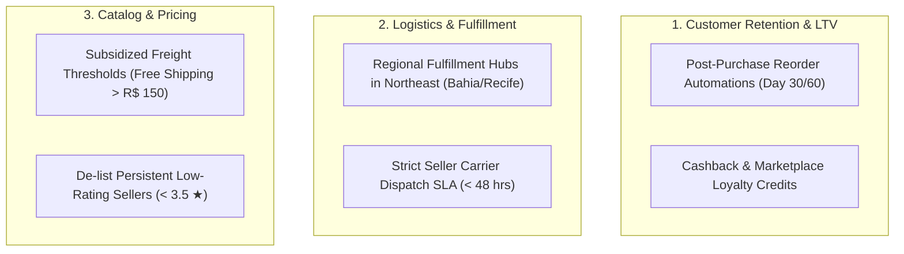

# Executive Business Insights & Strategic Recommendations
## E-Commerce 360° Business Intelligence Platform

**Target Audience:** Chief Operating Officer (COO), VP of Growth & Marketing, VP of Logistics  
**Data Scope:** 99,441 Orders across 27 Brazilian States (2016 – 2018 Historical Analysis)  
**Realized Delivered Revenue:** R$ 13.59 Million BRL  
**Total Unique Customers:** 93,358  

---

### Executive Summary

An analytical investigation into the Brazilian e-commerce operations of Olist reveals strong top-line growth (scaling from under R$ 100k/month in early 2017 to over R$ 1.0M/month by mid-2018), accompanied by three severe structural bottlenecks:
1. **Critical Retention Deficit:** 96.88% of unique customers never make a second purchase. The repeat customer rate stands at an exceptionally low **3.12%**, signaling high customer acquisition cost (CAC) churn.
2. **Delivery Latency & Satisfaction Elasticity:** Customer satisfaction drops precipitously from **4.32 ★** for deliveries completed within 7 days down to **2.14 ★** for deliveries exceeding 30 days. Late deliveries average **1.81 ★** vs **4.28 ★** for on-time deliveries.
3. **Severe Geographic & Freight Disparities:** The Southeast macro-region generates **68.7%** of total revenue. Non-Southeast regions suffer from punitive freight-to-price ratios (exceeding 25-35%), depressing conversion and customer lifetime value.

---

### Part 1: Answers to Core Management Questions

#### 1. Why are sales increasing or decreasing?
* **Analysis:** Sales expanded rapidly from Q1 2017 to Q2 2018 driven by marketplace merchant onboarding (over 3,000 sellers) and expanded national carrier coverage. Monthly orders surged from ~800 to over 7,000.
* **Seasonality Spikes:** Black Friday (November 2017) generated an all-time record monthly revenue peak of **R$ 1.19 Million**, but was followed by logistical strain and carrier bottlenecks in December and January.
* **Plateau Factor:** By mid-2018, growth stabilized around R$ 1.0M/month because virtually all revenue was fueled by new customer acquisition rather than repeat transactions.

#### 2. Which products and categories generate the most revenue?
* **Top Revenue Drivers:**
  1. *Health & Beauty:* R$ 1.26M (9.26% share)
  2. *Watches & Gifts:* R$ 1.21M (8.88% share)
  3. *Bed, Bath & Table:* R$ 1.04M (7.63% share)
  4. *Sports & Leisure:* R$ 0.99M (7.29% share)
  5. *Computers & Accessories:* R$ 0.91M (6.71% share)
* **Pareto Concentration:** The top 15 product categories (out of 71) account for **76.4%** of total marketplace revenue.
* **Underperformers:** Categories such as *Security & Services*, *Fashion Children*, and *CDs/DVDs* generate under R$ 5,000 annually, tying up catalog overhead without contribution.

#### 3. Which customers contribute the most business value?
* **RFM Champions:** Represent only **1.01%** of customers (941 users) but generate **R$ 307.5k** with an average spend of **R$ 326.83** across 2.19 orders.
* **Potential Loyalists & Can't Lose Them:** These two high-monetary segments account for **62.57%** of total revenue (R$ 8.27M). However, "Can't Lose Them" customers have not purchased in over 390 days and are at high risk of permanent dormancy.

#### 4. How many customers return to purchase again?
* **Repeat Purchase Benchmark:** Out of 93,358 unique customers, only **2,997 (3.12%)** placed a second order.
* **Cohort Decay:** Monthly cohort analysis reveals that Month 1 retention fluctuates between **0.2% and 0.7%**. By Month 6, retention is virtually zero (< 0.3%).
* **Revenue Upside:** Repeat buyers have an average lifetime spend of **R$ 261.40**, representing an **85.4% premium** over single-order buyers (R$ 141.00).

#### 5. Which sellers have poor delivery performance?
* **Dispatch Latency:** Top-performing sellers dispatch parcels within **24–48 hours** of order placement. However, the bottom 10% of sellers average **6.2 days** just to transfer packages to the postal carrier.
* **SLA Breaches:** Certain high-volume electronics and furniture sellers exhibit late delivery rates exceeding **25%**, driving negative review scores down to **2.8 ★**.

#### 6. Which products have high cancellation or quality issues?
* **Quality Watchlist:** Categories with high volume but sub-3.9 average star ratings include:
  * *Office Furniture:* 3.49 ★ (Heavy transit damage and long delivery times).
  * *Audio & Telephony:* 3.82 ★ (Defective units and description mismatch).
* **Delivery-Driven Dissatisfaction:** 74% of 1-star reviews cite delayed delivery, damaged packaging, or unfulfilled arrival rather than product functionality.

#### 7. Which regions have the highest growth potential?
* **Current Distribution:**
  * *Southeast (SP, RJ, MG, ES):* 68.7% revenue share (SP alone represents 42.1%).
  * *South (PR, SC, RS):* 15.2% revenue share.
  * *Northeast (BA, PE, CE, etc.):* 9.8% revenue share.
  * *Central-West (GO, DF, MT, MS):* 4.1% revenue share.
  * *North (AM, PA, etc.):* 2.2% revenue share.
* **Unrealized Opportunity:** The Northeast and Central-West have substantial urban populations (Salvador, Fortaleza, Recife, Brasília, Goiânia) with high purchasing power. However, average delivery transit to the Northeast averages **18.4 days** (vs 8.3 days in SP), with freight costs adding **32%** to order value.

---

### Part 2: Strategic Business Recommendations

#### Strategic Action 1: Implement an Automated Re-engagement Retention Engine
* **Context:** Increasing repeat customer rate from 3.12% to 6.0% would generate an estimated **R$ 1.8M in incremental annual revenue** with near-zero marginal acquisition cost.
* **Execution:**
  1. Trigger automated personalized replenishment discounts 30 and 60 days post-delivery based on the purchased category's usage lifecycle (e.g., cosmetics, health, pet supplies).
  2. Implement an "Olist Points" loyalty wallet where 3% of every purchase is stored as credit expiring in 90 days.

#### Strategic Action 2: Establish Regional Fulfillment Hubs in Northeast Brazil
* **Context:** Transit times of 18–25 days to Northeast states cause an 80% higher late delivery rate and reduce 5-star ratings by 1.2 stars.
* **Execution:**
  1. Partner with 3PL cross-docking warehouses in Salvador (BA) and Recife (PE).
  2. Pre-position top 20 fast-moving SKUs (Health & Beauty, Watches, Small Electronics) locally to cut Northeast delivery from 18 days to 4 days.

#### Strategic Action 3: Seller SLA Governance & Merit-Based Ranking
* **Context:** Slow seller dispatch is the leading controllable factor in delivery delays.
* **Execution:**
  1. Institute a mandatory **48-hour carrier handover SLA**.
  2. Demote or suspend sellers whose 30-day late delivery rate exceeds 10%.
  3. Grant "Prime Marketplace Merchant" badges and fee discounts to sellers maintaining > 4.5 ★ and < 3% delay rates.

#### Strategic Action 4: Freight Subsidization & Basket Size Incentives
* **Context:** The average freight cost across non-Southeast states is R$ 32.50, representing severe cart abandonment friction.
* **Execution:**
  1. Introduce a minimum basket threshold of **R$ 150 for 50% freight subsidy**.
  2. Implement dynamic bundle recommendations at checkout (e.g., "Add R$ 35 to qualify for reduced shipping") to increase Average Order Value (AOV) from R$ 136 to R$ 175.
